 

<!-- Optional: uncomment and add your links anytime

-->

---

### About

Computer Engineering student at **Institut Teknologi Sepuluh Nopember (ITS)** focusing on **C++, embedded firmware, IoT, and robotics**, alongside **native Apple software and applied computer vision**. I enjoy engineering close to hardware and sensors—from ESP32 microcontrollers and BLE telemetry up to on-device CoreML inference and concurrent Go backends.

---

### Selected Work

| Project | Domain | Summary |
| :--- | :--- | :--- |
| **[VirtualButtonApp](https://github.com/gungfebrian/VirtualButtonApp)** | `C++` · `ESP32` · `Swift` · `BLE` | Custom ESP32 firmware paired with a native iOS CoreBluetooth controller for low-latency IoT board control. |
| **[AlbertoDogRobot](https://github.com/gungfebrian/AlbertoDogRobot)** & **[SwiftServo](https://github.com/gungfebrian/SwiftServo)** | `C++` · `Swift` · `Robotics` | Quadruped robot firmware and servo-actuation experiments bridging mobile devices with physical hardware. |
| **[ADA Penyu](https://github.com/gungfebrian/Ada_Penyu_Mac)** · [Backend](https://github.com/gungfebrian/turtle-identification-be) · [Web](https://github.com/gungfebrian/adaPenyuWeb) | `SwiftUI` · `CoreML` · `Python` | Sea turtle facial-scale re-identification system combining on-device YOLO head detection, blur gating, visual pattern comparison, and migration mapping. |
| **[grab-hyperdispatch-go](https://github.com/gungfebrian/grab-hyperdispatch-go)** | `Go` · `Backend` | Concurrent dispatch system exploring geospatial matching, surge pricing, and double-entry wallet accounting. |
| **[autogit](https://github.com/gungfebrian/autogit)** | `TypeScript` · `Git` | Local CLI utility for generating safe Conventional Commit messages from staged Git diffs. |

---

### Core Toolkit

**Embedded, Hardware & Systems**

**Apple & Applied ML**

---

### GitHub Activity

