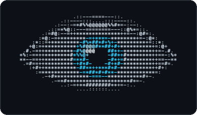

# Hi, I'm Gung Febrian 👋

---

Computer Engineering Student at ITS · Embedded & Systems

<!-- Uncomment and fill in your links anytime:

-->

---

## About Me

I'm a **Computer Engineering** student at **Institut Teknologi Sepuluh Nopember (ITS)** who enjoys building software close to hardware and sensors:

- Embedded firmware & IoT devices 
- Robotics & actuator control systems
- Native Apple apps with on-device computer vision
- backend services & developer tools

---

## Tech Stack

### Languages

### Embedded & Hardware

### Mobile & Computer Vision

### Tools

---

## What I Do

- Write **C++ firmware** and **BLE/IoT** interfaces for ESP32 boards and robotics ([VirtualButtonApp](https://github.com/gungfebrian/VirtualButtonApp), [AlbertoDogRobot](https://github.com/gungfebrian/AlbertoDogRobot))
- Build **native SwiftUI apps** with real-time on-device **CoreML** computer vision ([ADA Penyu](https://github.com/gungfebrian/Ada_Penyu_Mac))
- Design concurrent **Go** backend systems and local developer CLIs ([grab-hyperdispatch-go](https://github.com/gungfebrian/grab-hyperdispatch-go), [autogit](https://github.com/gungfebrian/autogit))

---

## GitHub Stats

| Overview | Language |
| :---: | :---: |
|  |  |
